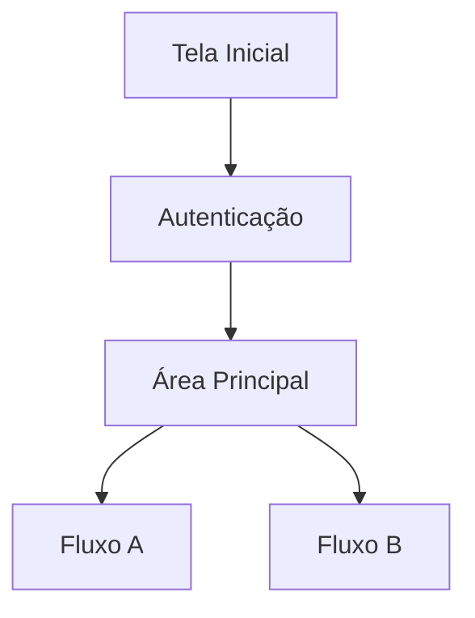
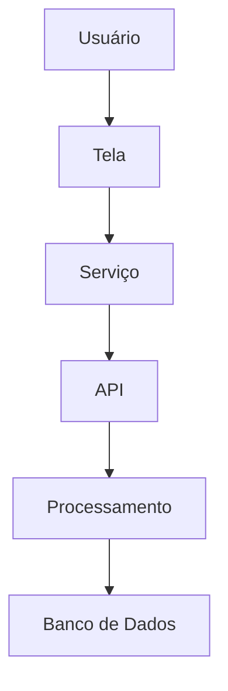
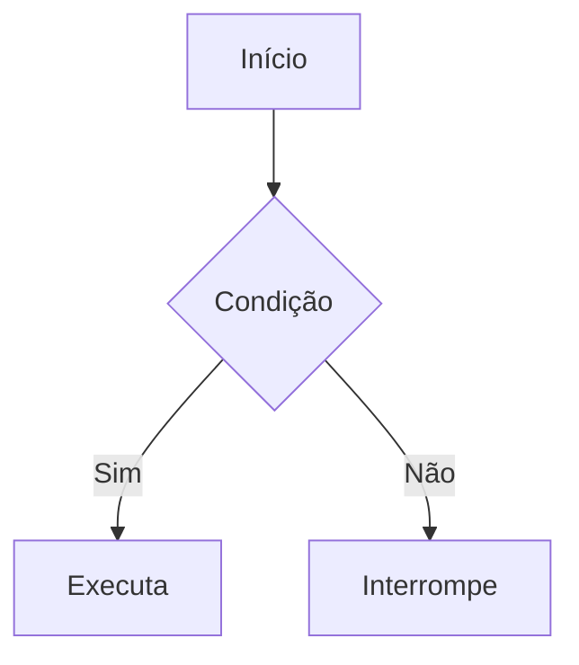
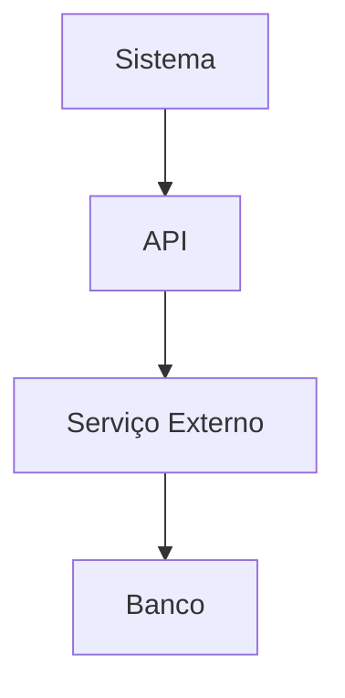

# Instrução para Análise e Geração de Documentação Técnica de Aplicações

## Objetivo

Realizar uma análise completa da aplicação, identificando fluxos funcionais, navegação, integrações, APIs consumidas, regras de negócio e dependências entre componentes para geração de documentação técnica.

A análise deve ser baseada exclusivamente no código efetivamente utilizado pela aplicação.

O objetivo não é refatorar, corrigir ou implementar funcionalidades, mas compreender o funcionamento atual do sistema e produzir documentação técnica clara, organizada e rastreável.

## Diretrizes Gerais

### O que deve ser analisado

- Fluxos de navegação.
- Telas, páginas ou componentes principais.
- Serviços internos.
- APIs consumidas.
- APIs expostas.
- Regras de negócio.
- Validações.
- Fluxos de autenticação.
- Fluxos de autorização.
- Processos assíncronos.
- Integrações externas.
- Dependências entre módulos.
- Estruturas de dados utilizadas.
- Persistência de dados.
- Tratamento de erros.
- Componentes reutilizáveis.

### O que não deve ser feito

- Refatorar código.
- Corrigir problemas encontrados.
- Alterar arquitetura.
- Criar novas funcionalidades.
- Modificar nomenclaturas.
- Reescrever código existente.

O trabalho consiste exclusivamente em análise e documentação.

## Metodologia de Análise

A análise deve ocorrer em camadas.

### Camada 1 — Navegação

Mapear a navegação da aplicação.

Identificar:

- Tela inicial.
- Fluxos de entrada.
- Fluxos de saída.
- Menus.
- Rotas.
- Navegações condicionais.
- Navegações por perfil.
- Fluxos alternativos.

Documentar:

- Nome:
- Objetivo:
- Origem:
- Destinos possíveis:
- Condições de acesso:
- Permissões:
- Arquivos envolvidos:

### Camada 2 — Fluxos Funcionais

Identificar os principais processos executados pelo sistema.

Para cada fluxo documentar:

- Nome do Fluxo:
- Objetivo:
- Ponto de Entrada:
- Etapas:
- Resultado Esperado:
- Possíveis Erros:
- Arquivos envolvidos:

### Camada 3 — Serviços e Integrações

Localizar todos os serviços utilizados pela aplicação.

Identificar:

- Chamadas HTTP.
- Serviços internos.
- Serviços externos.
- Mensageria.
- Filas.
- WebSockets.
- Jobs.
- Processamentos assíncronos.

Documentar:

- Nome:
- Tipo:
- Objetivo:
- Origem da chamada:
- Destino:
- Arquivos envolvidos:

### Camada 4 — APIs

Identificar todas as APIs consumidas ou expostas.

Documentar:

- Método:
- Endpoint:
- Finalidade:
- Origem da chamada:
- Payload enviado:
- Payload recebido:
- Possíveis retornos:
- Possíveis erros:
- Autenticação necessária:
- Arquivos envolvidos:

### Camada 5 — Regras de Negócio

Identificar regras implementadas na aplicação.

Documentar:

- Nome da Regra:
- Descrição:
- Condição:
- Resultado:
- Localização:
- Dependências:

### Camada 6 — Persistência

Identificar como os dados são armazenados.

Documentar:

- Entidade:
- Origem:
- Destino:
- Operação:
- Arquivos envolvidos:

### Camada 7 — Tratamento de Erros

Identificar tratamentos existentes.

Documentar:

- Cenário:
- Origem:
- Tratamento:
- Mensagem apresentada:
- Impacto:

## Diagramas

Sempre que aplicável utilizar Mermaid para facilitar a compreensão dos fluxos.

Utilizar apenas quando agregar valor à documentação.

### Fluxos de Navegação



### Fluxos de Processamento



### Fluxos de Decisão



### Fluxos de Integração



## Matriz de Dependências

Gerar tabela contendo:

| Componente   | Depende de | Tipo de Dependência |
| ------------ | ---------- | ------------------- |
| Componente A | Serviço B  | Direta              |
| Serviço B    | API C      | Direta              |
| API C        | Banco D    | Direta              |

## Matriz de Fluxos

Gerar tabela contendo:

| Fluxo   | Entrada | Processamento | Saída       |
| ------- | ------- | ------------- | ----------- |
| Fluxo A | Tela X  | Serviço Y     | Resultado Z |

## Identificação de Problemas

Identificar possíveis problemas arquiteturais.

Documentar:

- Tipo:
- Descrição:
- Localização:
- Impacto:
- Evidência:

Exemplos:

- Acoplamento excessivo.
- Regras duplicadas.
- Dependências circulares.
- Componentes sem uso.
- Serviços sem uso.
- APIs sem uso.
- Fluxos inacessíveis.
- Código morto.
- Validações duplicadas.
- Responsabilidades misturadas.

## Componentes Sem Uso

Identificar:

- Classes sem referência.
- Serviços sem referência.
- Endpoints não utilizados.
- Telas inacessíveis.
- Componentes órfãos.
- Funções não utilizadas.

Documentar:

- Nome:
- Tipo:
- Localização:
- Motivo da classificação:

## Estrutura Esperada da Documentação

```text
docs/
  01-visao-geral.md
  02-navegacao.md
  03-fluxos-funcionais.md
  04-servicos.md
  05-integracoes.md
  06-apis.md
  07-regras-negocio.md
  08-persistencia.md
  09-tratamento-erros.md
  10-dependencias.md
  11-componentes-sem-uso.md
  12-problemas-identificados.md
```

## Critérios de Qualidade

A documentação gerada deve:

- Ser baseada em evidências do código.
- Informar arquivos envolvidos.
- Informar dependências.
- Ser rastreável.
- Utilizar diagramas Mermaid quando facilitar o entendimento.
- Evitar suposições.
- Destacar dúvidas quando não houver evidência suficiente.
- Diferenciar claramente fatos observados de hipóteses.
- Priorizar clareza e completude sobre quantidade de informação.
